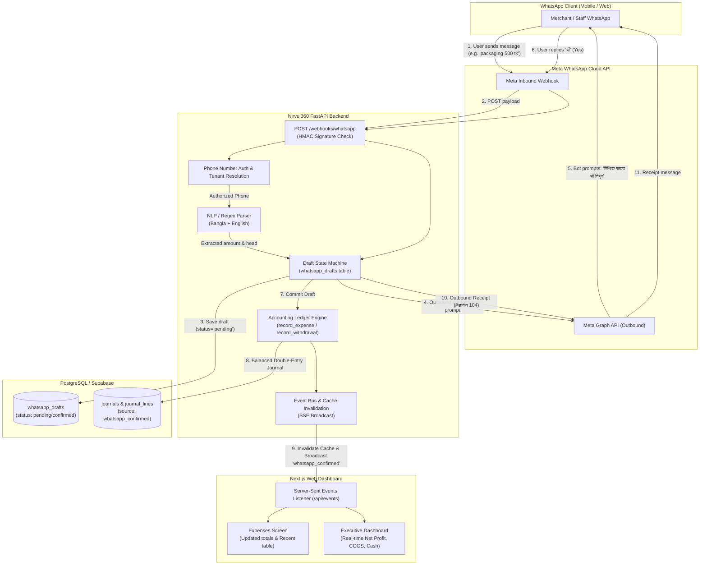
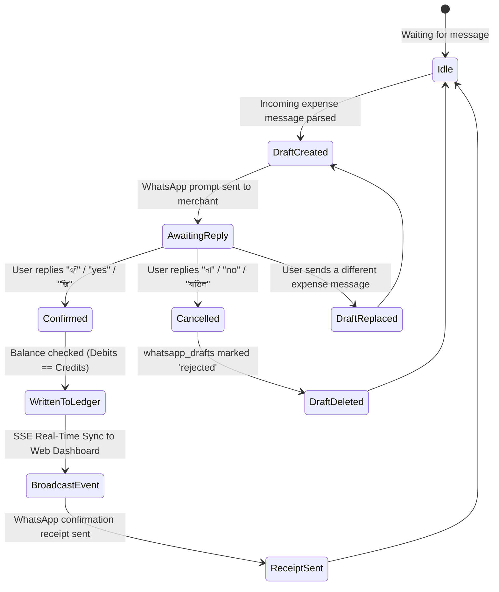

# WhatsApp Chat Assistant — Implementation & Architecture Guide

This document is the comprehensive technical and operational specification for the **WhatsApp Chat Assistant** in the Nirvul360 / Gross Management platform.

It details how clients, merchants, and operations staff can submit miscellaneous expenses, courier fees, operational charges, and order status updates over WhatsApp, which are parsed, verified via a 2-step confirmation workflow, posted into the double-entry accounting ledger, and reflected in real time on the web dashboard.

---

## Table of Contents
1. [Executive Summary & Core Objectives](#1-executive-summary--core-objectives)
2. [High-Level Architecture & Data Flow](#2-high-level-architecture--data-flow)
3. [Meta WhatsApp Cloud API Configuration](#3-meta-whatsapp-cloud-api-configuration)
4. [Natural Language & Command Engine](#4-natural-language--command-engine)
5. [2-Step Confirmation State Machine](#5-2-step-confirmation-state-machine)
6. [Double-Entry Accounting Ledger Integration](#6-double-entry-accounting-ledger-integration)
7. [Real-Time Dashboard & UI Synchronization](#7-real-time-dashboard--ui-synchronization)
8. [Interactive In-App Simulator (Zero-API Key Testing)](#8-interactive-in-app-simulator-zero-api-key-testing)
9. [Security, Authentication & Signature Verification](#9-security-authentication--signature-verification)
10. [Codebase Reference & Directory Structure](#10-codebase-reference--directory-structure)

---

## 1. Executive Summary & Core Objectives

### The Business Problem
In Bangladeshi e-commerce and retail operations:
- Up to 40% of petty cash expenses (packaging tapes, delivery bags, spot courier tips, transit rickshaw fare, tea/snacks) are paid in cash on the floor and never get logged into accounting systems.
- Reconciling courier charges and consignment statuses (e.g. delivered, returned) often lags behind physical operations by several days.
- Asking merchants or floor managers to open a complex web dashboard every time they spend ৳150 creates friction and compliance drop-off.

### The Solution: WhatsApp Conversational Ledger
- **Zero-Friction Ingestion**: Users send casual messages in Bangla, English, or Banglish (e.g. `packaging 500 tk`, `কুরিয়ার চার্জ ১৫০ টাকা`, `order #1894 delivered`).
- **Strict Anti-Mistake Protection (2-Step Confirmation)**: Messages are never posted directly into accounting books. They are drafted and presented back to the user with exact amounts, heads, and dates. Posting occurs **only** when the user affirms (`হ্যাঁ` / `yes`).
- **Strict Double-Entry Invariants**: Every confirmed entry produces balanced Debits and Credits with source provenance (`source = 'whatsapp_confirmed'`).
- **Instant Real-Time UI Sync**: As soon as a WhatsApp entry is confirmed, the web dashboard recalculates P&L, updates operating expenses, and highlights the entry in real time via Server-Sent Events (SSE).

---

## 2. High-Level Architecture & Data Flow



---

## 3. Meta WhatsApp Cloud API Configuration

To operate the live WhatsApp assistant, configure credentials in your `.env` file and set up the webhook in Meta for Developers.

### Required Environment Variables (`.env`)

```env
# ==============================================================================
# WHATSAPP CLOUD API CONFIGURATION (META FOR DEVELOPERS)
# ==============================================================================
WHATSAPP_TOKEN=EAAG...                  # Permanent System User Access Token
WHATSAPP_PHONE_NUMBER_ID=105938472910    # Assigned Phone Number ID from Meta
WHATSAPP_BUSINESS_ACCOUNT_ID=waba_10293  # WhatsApp Business Account ID
WHATSAPP_VERIFY_TOKEN=gross_verify_token # Secret string you choose for webhook handshake
WHATSAPP_APP_SECRET=a8b3c4d5e6f7...      # App Secret for HMAC-SHA256 signature verification

# Optional: Claude AI for fallback parsing (built-in regex runs at $0 cost)
ANTHROPIC_API_KEY=
```

### Step-by-Step Meta Setup Guide

#### Step 1: Create a Meta App
1. Go to [Meta for Developers](https://developers.facebook.com/) and log in with your Facebook account.
2. Click **My Apps** -> **Create App**.
3. Select **Other** as the use case -> Select **Business** as the app type.
4. Name your app (e.g. `Nirvul360 Assistant`) and link your Meta Business Account.

#### Step 2: Add WhatsApp Product
1. In the App Dashboard, scroll to **Add Products to your app** and click **Set Up** on **WhatsApp**.
2. You will be redirected to the **API Setup** page.
3. Meta will assign you a temporary test phone number and a test **Phone number ID**.
4. For production, click **Add Phone Number** to register your official business SIM/landline.

#### Step 3: Generate Permanent System User Access Token
> [!IMPORTANT]
> The temporary token on the API Setup page expires after 24 hours. For production 24/7 reliability, create a Permanent System User Token:
1. Open [Meta Business Manager](https://business.facebook.com/settings).
2. Go to **Users** -> **System Users** -> Click **Add**.
3. Set role to **Admin**.
4. Click **Generate New Token**, select your WhatsApp App, and grant these permissions:
   - `whatsapp_business_messaging`
   - `whatsapp_business_management`
5. Copy the generated token into `WHATSAPP_TOKEN` in your `.env`.

#### Step 4: Configure Webhook
1. In Meta App Dashboard, navigate to **WhatsApp** -> **Configuration**.
2. Under **Webhook**, click **Edit**:
   - **Callback URL**: `https://<your-public-domain>/webhooks/whatsapp`
   - **Verify Token**: Enter the exact same string set in `WHATSAPP_VERIFY_TOKEN` (e.g. `gross_verify_token`).
3. Click **Verify and Save**. Meta will make an instant `GET` request to your backend with `hub.challenge`.
4. Click **Manage Webhook Fields**, find `messages`, and check **Subscribe**.

---

## 4. Natural Language & Command Engine

The assistant uses an optimized, zero-latency natural language parser in [`backend/app/whatsapp/parser.py`](file:///backend/app/whatsapp/parser.py). It detects digits in both English and Bengali, maps financial heads, and identifies operational intents.

### A. Operational & Miscellaneous Expenses

| Command / Message | Detected Head | Canonical Account | Action on "হ্যাঁ" Confirmation |
| :--- | :--- | :--- | :--- |
| `packaging 500 tk` / `প্যাকেজিং ৫০০ টাকা` | `packaging` | `5200` Packaging Expense | Debits Packaging Expense ৳500, Credits Cash ৳500 |
| `courier charge 150 tk` / `কুরিয়ার চার্জ ১৫০ টাকা` | `courier_delivery` | `5150` Courier Delivery Expense | Debits Courier Expense ৳150, Credits Cash ৳150 |
| `staff salary 12000 tk` / `বেতন ১২০০০ টাকা` | `salary` | `5250` Salaries & Wages | Debits Salary Expense ৳12,000, Credits Cash ৳12,000 |
| `shop rent 15000 tk` / `দোকান ভাড়া ১৫০০০ টাকা` | `rent` | `5300` Rent Expense | Debits Rent Expense ৳15,000, Credits Cash ৳15,000 |
| `electric bill 2400 tk` / `কারেন্ট বিল ২৪০০ টাকা` | `utilities` | `5350` Utilities Expense | Debits Utilities Expense ৳2,400, Credits Cash ৳2,400 |
| `rickshaw fare 80 tk` / `যাতায়াত খরচ ৮০ টাকা` | `transport` | `5400` Travel & Conveyance | Debits Transport Expense ৳80, Credits Cash ৳80 |
| `facebook boost 2500 tk` / `বিজ্ঞাপন ২৫০০ টাকা` | `ad_spend` | `5050` Advertising & Marketing | Debits Ad Spend ৳2,500, Credits Cash ৳2,500 |
| `nasta 120 tk` / `নাস্তা খরচ ১২০ টাকা` | `other_expense` | `5500` Miscellaneous Expense | Debits Misc Expense ৳120, Credits Cash ৳120; Flags unallocated head |

### B. Owner Withdrawals vs. Operating Expenses
> [!CAUTION]
> Double-entry integrity requires that owner personal cash withdrawals are **never** logged as operating expenses, as doing so would falsely depress company Net Profit and distort tax accounting.
- **Message**: `tulilam 5000 tk` / `ব্যক্তিগত উত্তোলন ৫০০০ টাকা` / `withdraw 5000`
- **Detected Intent**: `withdrawal`
- **Accounting Action**: Debits `3010 Owner Drawings (Equity)`, Credits `1010 Cash on Hand`. Operating expense remains unchanged; net profit is preserved.

### C. Order & Consignment Updates
- **Message**: `order #1894 delivered` / `অর্ডার ১০৫ ডেলিভারি সম্পন্ন`
- **Detected Intent**: `order_status_update`
- **Action**: Transitions order state in `orders` table to `delivered`, triggers COGS recognition, updates real-time pipeline on dashboard.

### D. Real-Time Performance & P&L Queries
- **Message**: `আজকের হিসাব`, `today's profit`, `summary`, `লাভ`
- **Action**: Queries live P&L engine ([`reports.py`](file:///backend/app/domain/reports.py)) and replies immediately:
  ```text
  📊 আজকের সংক্ষিপ্ত হিসাব:
  • ডেলিভারি সেলস: ৳১৮,৪৫০.০০
  • পণ্যের ক্রয়মূল্য (COGS): ৳৯,২০০.০০
  • আজকের নিট লাভ: ৳৫,১৩০.০০
  ```

---

## 5. 2-Step Confirmation State Machine

To prevent erroneous posts or misparsed text from contaminating financial statements, the assistant implements a rigid **2-Step Confirmation State Machine**:



### State Machine Rules
1. **Initial Message**:
   - Creates a record in `whatsapp_drafts` with `status = 'pending'`, `stage = 'confirm'`.
   - The double-entry ledger is **100% untouched**.
   - Replies to user:
     ```text
     📝 এই এন্ট্রিটি ড্রাফট করা হয়েছে:
       খাত: প্যাকেজিং ও ব্যাগ
       পরিমাণ: ৳৫০০.০০
       তারিখ: 2026-11-11

     নিশ্চিত করতে 'হ্যাঁ' লিখুন, অথবা বাতিল করতে 'না' লিখুন।
     ```
2. **Confirmation (`is_yes`)**:
   - Recognized words: `হ্যাঁ`, `হাঁ`, `জি`, `ঠিক আছে`, `yes`, `y`, `ok`, `okay`, `thik ase`.
   - Transitions draft `status = 'confirmed'`.
   - Calls `record_expense()` inside an ACID database transaction.
   - Generates double-entry journal entry with `source = 'whatsapp_confirmed'`.
   - Broadcasts real-time event via SSE to connected browsers.
   - Sends confirmation receipt:
     ```text
     ✅ লিখে রাখা হয়েছে (জার্নাল #104)। ড্যাশবোর্ডে 'WhatsApp' ট্যাগসহ দেখা যাবে।
     ```
3. **Cancellation (`is_no`)**:
   - Recognized words: `না`, `ভুল`, `cancel`, `বাতিল`, `থাক`, `no`, `n`.
   - Transitions draft `status = 'rejected'`.
   - Sends feedback: `❌ এন্ট্রি বাতিল করা হয়েছে। কোনো তথ্য লেজারে লেখা হয়নি।`

---

## 6. Double-Entry Accounting Ledger Integration

Nirvul360 adheres to strict double-entry bookkeeping rules. Every WhatsApp transaction satisfies the accounting equation:
$$\Delta \text{Assets} = \Delta \text{Liabilities} + \Delta \text{Equity} + (\text{Revenues} - \text{Expenses})$$

### Journal Entry Posting (`source = 'whatsapp_confirmed'`)
When a ৳500 packaging expense is confirmed:

```sql
-- 1. Insert Master Journal Entry
INSERT INTO journals (merchant_id, entry_date, description, source, reference, created_at)
VALUES (1, '2026-11-11', 'WhatsApp: packaging 500 tk', 'whatsapp_confirmed', 'draft_42', '2026-11-11T14:30:00Z');

-- 2. Insert Debit Line (Packaging Expense 5200)
INSERT INTO journal_lines (journal_id, account_id, debit_poisha, credit_poisha)
VALUES (104, (SELECT id FROM accounts WHERE code = '5200'), 50000, 0);

-- 3. Insert Credit Line (Cash on Hand 1010)
INSERT INTO journal_lines (journal_id, account_id, debit_poisha, credit_poisha)
VALUES (104, (SELECT id FROM accounts WHERE code = '1010'), 0, 50000);
```

### Invariant Checks
1. `SUM(debit_poisha) == SUM(credit_poisha)` enforced by `assert_balanced()` in [`backend/app/domain/ledger.py`](file:///backend/app/domain/ledger.py).
2. Provenance tag `whatsapp_confirmed` is permanently stamped on the journal record for financial auditability.

---

## 7. Real-Time Dashboard & UI Synchronization

As soon as a draft is committed:
1. **Cache Invalidation**:
   - Calls `invalidate_dashboard_cache()` and `invalidate_expenses_cache()`.
2. **Server-Sent Events (SSE)**:
   - Backend event bus broadcasts:
     ```json
     {
       "event": "whatsapp_confirmed",
       "data": {
         "ref": "জার্নাল #104",
         "intent": "expense",
         "merchantId": 1
       }
     }
     ```
3. **Frontend Dynamic Reaction**:
   - [`frontend/src/components/ExpensesView.tsx`](file:///frontend/src/components/ExpensesView.tsx):
     - Increments the WhatsApp Confirmed badge count.
     - Refreshes the 6 expense category cards.
     - Prepends the newly booked entry to the **Recent entries** table with the green pill: `WhatsApp · confirmed just now`.
   - **Executive Dashboard**:
     - Operating expenses line item increases.
     - Net profit and Net margin recalculate instantly.

---

## 8. Interactive In-App Simulator (Zero-API Key Testing)

You do **not** need a live Meta WhatsApp developer account to test or demonstrate this feature. The project includes an **In-App Simulator**:

- **Location in UI**: Open the WhatsApp Assistant drawer from the top navigation bar or the floating action button.
- **Component**: [`frontend/src/components/WhatsAppAssistantView.tsx`](file:///frontend/src/components/WhatsAppAssistantView.tsx)
- **Backend Endpoints**:
  - `POST /api/whatsapp/simulate`: Simulates an incoming text message as if sent by the merchant's registered phone.
  - `POST /api/whatsapp/confirm`: Simulates tapping or typing "হ্যাঁ".
  - `POST /api/whatsapp/reject`: Simulates tapping or typing "না".
  - `GET /api/whatsapp/overview`: Returns telemetry, authorized staff phone numbers, and past 50 confirmation logs.

```text
[Simulator Screen Example]
User:  packaging 500 tk
Bot:   📝 এই এন্ট্রিটি ড্রাফট করা হয়েছে:
         খাত: প্যাকেজিং ও ব্যাগ
         পরিমাণ: ৳৫০০.০০
       নিশ্চিত করতে 'হ্যাঁ' লিখুন, অথবা বাতিল করতে 'না' লিখুন।
User:  হ্যাঁ
Bot:   ✅ লিখে রাখা হয়েছে (জার্নাল #104)। ড্যাশবোর্ডে 'WhatsApp' ট্যাগসহ দেখা যাবে।
```

---

## 9. Security, Authentication & Signature Verification

1. **HMAC-SHA256 Payload Signature Check**:
   Every incoming request to `POST /webhooks/whatsapp` is validated using the header `x-hub-signature-256` and `WHATSAPP_APP_SECRET`:
   ```python
   expected = hmac.new(secret.encode('utf-8'), raw_body, hashlib.sha256).hexdigest()
   if not hmac.compare_digest(signature[7:], expected):
       raise HTTPException(status_code=401, detail="signature mismatch")
   ```
2. **Phone Whitelist & Role-Based Authorization**:
   - Unregistered numbers receive: `দুঃখিত, এই নম্বরটি কোনো মার্চেন্ট অ্যাকাউন্টের সাথে যুক্ত নেই।`
   - Staff roles (`staff`, `packer`) are capped at operational expenses (e.g. up to ৳5,000).
   - Only `owner` and `admin` roles are permitted to record withdrawals (`উত্তোলন`).
3. **Idempotency & Replay Prevention**:
   - Meta message IDs (`wamid`) are deduplicated to ensure duplicate webhook deliveries do not create duplicate ledger entries.

---

## 10. Codebase Reference & Directory Structure

| Layer | File Path | Primary Function |
| :--- | :--- | :--- |
| **Parser** | [`backend/app/whatsapp/parser.py`](file:///backend/app/whatsapp/parser.py) | NLP keyword detection, Bengali digit conversion, amount extraction. |
| **State Machine** | [`backend/app/whatsapp/assistant.py`](file:///backend/app/whatsapp/assistant.py) | 2-step confirmation loop, draft creation, commit/reject handlers. |
| **Meta Client** | [`backend/app/whatsapp/client.py`](file:///backend/app/whatsapp/client.py) | Outbound WhatsApp message dispatcher via Meta Graph API v18.0. |
| **Webhook Handler** | [`backend/app/api/webhooks.py`](file:///backend/app/api/webhooks.py) | Inbound endpoint for Meta challenge handshake & incoming messages. |
| **API Endpoints** | [`backend/app/api/whatsapp.py`](file:///backend/app/api/whatsapp.py) | Authenticated dashboard endpoints (`/overview`, `/conversation`, `/simulate`). |
| **Double-Entry Engine** | [`backend/app/domain/entries.py`](file:///backend/app/domain/entries.py) | Books balanced journals with `source = 'whatsapp_confirmed'`. |
| **Frontend Simulator** | [`frontend/src/components/WhatsAppAssistantView.tsx`](file:///frontend/src/components/WhatsAppAssistantView.tsx) | Live interactive chat simulator and audit log viewer. |
| **Expenses View** | [`frontend/src/components/ExpensesView.tsx`](file:///frontend/src/components/ExpensesView.tsx) | Displays real-time expense head breakdown and WhatsApp-tagged entries. |
